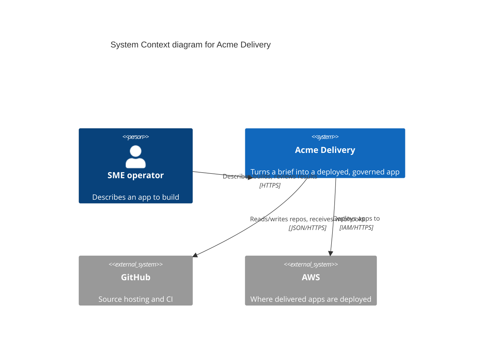
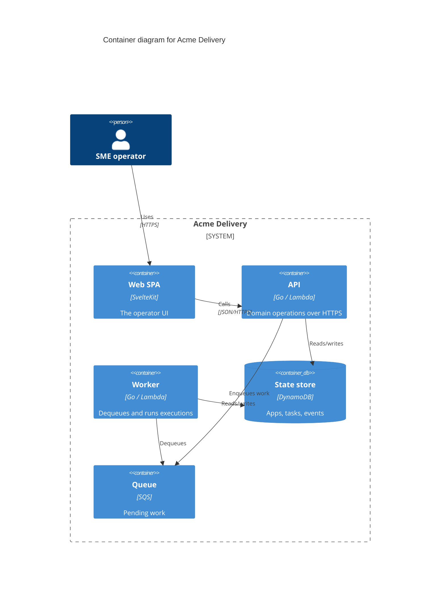

Source: The C4 model (https://c4model.com/), Simon Brown. Distilled reference — verify against the live source.

# C4 notation, supplementary diagrams, and worked examples

C4 is notation-independent, but a good diagram is **self-describing**: a reader with
no prior context can decode every box, line, and colour from the diagram and its key.

## The notation rules in full

### Elements (boxes)

Every element must carry:

- **Name** — what it is ("Delivery Orchestrator", "Web SPA").
- **Type** — the C4 element type, shown explicitly: *Person*, *Software System*,
  *Container*, or *Component*. Often rendered as "[Container: Go]".
- **Technology** (containers and components only) — the implementation tech, e.g.
  "[Container: Go / Lambda]", "[Container: React SPA]", "[Container: DynamoDB]".
  Omit for Person and Software System (a system is technology-agnostic at that zoom).
- **Description** — one line on the element's responsibility. Keep it short; it's a
  caption, not a paragraph.

Mark **external** elements (systems/people outside your ownership or scope)
distinctly — a different fill colour and/or an explicit "[external]" so the reader can
see the boundary of what you build versus what you depend on.

### Relationships (lines)

- **Directed** — an arrow showing who initiates.
- **Labelled with intent** — describe the dependency in words: "Reads from",
  "Sends build events to", "Authenticates via". A line with no label is a defect.
- **Technology/protocol** where it matters — "[JSON/HTTPS]", "[gRPC]", "[SQS]".
- Avoid a spaghetti of lines; if two elements have many interactions, summarise, or
  use a Dynamic diagram to show the detailed sequence.

### Diagram furniture

- **Title** — state the *level* and *scope*: "System Context diagram for <System>",
  "Container diagram for <System>", "Component diagram for <Container>".
- **Key / legend** — mandatory. Explain every shape, colour, border style, and
  acronym used. Consistency of meaning across your diagram set matters more than which
  specific colours you pick.
- **Layout** — aim for readability: important elements central, flow top-to-bottom or
  left-to-right, minimal line crossings.

## The abstraction cheat-sheet

| Abstraction | Is it separately deployable? | Example |
| --- | --- | --- |
| Person | n/a (a human role) | "SME operator", "End user" |
| Software System | yes — the whole thing | "Albitor", "Stripe", "GitHub" |
| Container | yes — a runnable/storable unit | API service, SPA, database, queue, Lambda, bucket |
| Component | no — lives inside a container | Controller, service, repository, adapter |
| Code | no — inside a component | Class, interface, function |

Remember: **Container ≠ Docker container.** A container is anything that executes code
or stores data as a distinct runnable/deployable unit.

## Supplementary diagrams

### System Landscape

Zoom *out* past a single system. Shows many software systems and people across a
domain or enterprise and how they relate — the "map of maps". Use it when the
organisation runs multiple systems and you need to place yours in that wider estate.
It's a System Context view without a single system in focus.

### Dynamic diagram

Shows how elements *collaborate at runtime* to satisfy one specific use case or
feature. Number the interactions (1, 2, 3…) to convey order — a lighter-weight cousin
of a UML sequence/communication diagram. Use it to explain a non-obvious flow (e.g.
"how an inbound webhook becomes a queued execution"). Elements can be systems,
containers, or components — whatever level the flow is best told at.

### Deployment diagram

Maps containers to **infrastructure**: deployment nodes (physical/virtual servers,
regions, availability zones, Kubernetes clusters, serverless platforms, device
types), and *which container instance runs where*. A deployment node can be nested
(region → cluster → node → container). One logical container can map to many
deployment nodes (e.g. replicated across zones). Use it to show *where* the system
runs and how it's distributed — invaluable for cloud/serverless topologies.

## Worked example (Mermaid C4)

A minimal System Context diagram:

A Container diagram (zooming into the system):

Notice: every box has a type and (where relevant) a technology; every line is
labelled; the diagram has a title; internal containers sit inside the system boundary
and externals sit outside it.

## Common mistakes

- Treating "Container" as a Docker container and drawing infra instead of runnable
  units (infra belongs in a Deployment diagram).
- Unlabelled lines, or lines without direction.
- No legend, so colours/shapes mean nothing to a fresh reader.
- Mixing abstraction levels in one diagram (a class next to a whole system).
- Drawing Code-level diagrams by hand and letting them rot — generate them instead.
- Trying to put everything on one diagram instead of zooming across levels.
